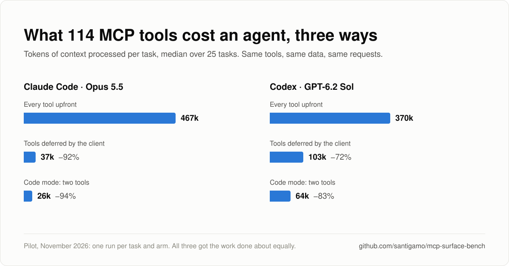

# mcp-surface-bench

<div align="center">

<picture>
  <source media="(prefers-color-scheme: dark)" srcset="assets/context-per-task-dark.svg">
  
</picture>

<h3>114 MCP tools, three ways to show them to an agent</h3>

<p>With every tool loaded upfront, Claude read <strong>467k tokens per task</strong>. Loading tools on demand cut that to <strong>37k</strong>. Code mode got it to <strong>26k</strong>. All three got the work done about equally.</p>

[](./LICENSE)
[](https://bun.sh)
[](https://www.typescriptlang.org)
[](https://modelcontextprotocol.io)

</div>

---

I took a real MCP server with 114 tools, rebuilt it from its public docs over a made-up company, and ran
its own 25 example prompts through Claude Code and Codex. Same tools, same data, same requests. The only
thing that changes is what the model gets to see:

| Arm | What the model sees |
| --- | --- |
| `direct` | Every tool, with its full definition, from the first request. |
| `direct+search` | The same server, but the client holds the definitions back and the model searches for the tools it needs (Claude Code's tool search, Codex's default). |
| `code` | Two tools: one searches the server's functions and returns their signatures, the other runs JavaScript that calls them ("code mode"). |

## The server

The tools are the ones in [Distru's MCP server](https://docs.distru.com/mcp), an ERP for the cannabis
industry: 114 tools, 38 of them writes. I picked it because it's big and the docs are unusually good.
Every tool has a public page with the description the model reads, every input and every output field,
so I could rebuild the tool list without guessing.

I'm not affiliated with Distru and this never connects to their server. `bun run catalog` reads the public
docs and builds the tool list from them, and the docs themselves aren't copied into this repo. Behind the
tools there's a made-up company, generated for the day of the run, with handlers written from the docs.
The tasks are the 25 example prompts in those docs ("Try asking"), unedited.

## Pilot results

One run per task and arm on 2026-11-23: 75 runs per client. The full reports are in [`pilot/`](pilot).

**Claude Code 2.1.330, `claude-opus-5-5`, effort medium**

| | `direct` | `direct+search` | `code` |
| --- | --- | --- | --- |
| Context in the first request | 155k tokens | 5.3k | 3.2k |
| Context processed per task, median | 467k tokens | 37k | 26k |
| Wall time per task, median | 12 s | 16 s | 18 s |
| Passed / asked / failed, of 25 | 23 / 2 / 0 | 22 / 3 / 0 | 22 / 3 / 0 |

**Codex CLI 0.167.0, `gpt-6.2-sol`, effort medium**

| | `direct` | `direct+search` | `code` |
| --- | --- | --- | --- |
| Context processed per task, median | 370k tokens | 103k | 64k |
| Wall time per task, median | 22 s | 20 s | 22 s |
| Passed / asked / failed, of 25 | 24 / 1 / 0 | 23 / 1 / 1 | 25 / 0 / 0 |

"Context processed" is every token the model read or wrote over the run. "Asked" is a run that stopped to
put a question to the user and changed nothing: neither a pass nor a failure. Codex does not report the
size of its first request.

What I found:

1. **Holding the definitions back saves most of the context, and code mode saves more on top.** With every
   tool upfront, 98% of what Claude processed was the tool list, read again on each turn. Deferring it cut
   the median from 467k to 37k tokens; code mode brought it to 26k. Codex went from 370k to 103k and 64k.
2. **The arms got the work done about equally.** One run per task cannot separate them, and none of them
   failed a task on Claude. Codex's single failure comes from the pilot's setup: the agent and the mock
   company were in different timezones. The runner handles that now.
3. **Two of the 25 example prompts cannot be completed as asked without a follow-up question.**
   "Turn off ordering on the Bay Area menu": there is no such switch. Claude laid out the two closest
   settings and asked which, in all three arms; Codex turned off partner orders, in all three.
   "Record a $2,500 payment against purchase order 1182": a payment method is required and the request names
   none. Five of the six runs asked for it; Codex in code mode used ACH, the method of the order's earlier
   payment.
4. **One thing to replicate.** "What did the public API change yesterday?" was answered by Claude with the
   tools upfront. In both arms where the definitions were held back, it read the question as being about
   changes to the API itself, found nothing and asked what was meant. With the definitions in view, the
   model also has the product in view. This is one run per arm.

What this doesn't show:

- Anything about pass rates beyond "about equal". I'd need repetitions for that.
- The real server. The schemas are rebuilt from documentation tables, the data is invented, and 63 of the
  114 tools have a handler (the rest are listed, and refuse a call with a clear message; one call in 150 runs
  reached one).
- A production design for code mode. The `code` arm is this repo's own design, and it runs model-written code in
  `node:vm`, which isn't a security boundary.

The graders use no model. They needed fixing twice after the pilot, because they were failing correct
answers that added a helpful remark. The stored runs were then graded again, and each run keeps its
earlier verdicts. [`suites/erp/README.md`](suites/erp/README.md) states every task's rule, its traps and
the readings fixed in advance for the ambiguous prompts.

## How it's built

I built this with coding agents: I set the design, the rules and the checks, and agents wrote most of the
code under review.

| Path | What it does |
| --- | --- |
| `src/catalog/` | Builds each tool's name, description and JSON Schema from the vendor's documentation. A test converts every schema back into the documented table to prove no field, type, enum value or required flag is lost. |
| `src/core/` | One runtime carries out every tool call, whatever the arm: it validates the arguments, calls the handler and writes a trace. The arms differ only in what they show the model. |
| `src/surfaces/` | The `direct` and `code` MCP servers. |
| `suites/erp/` | The company, the handlers, and the 25 tasks with their graders. |
| `src/bench/` | The runner and the report: drives Claude Code and Codex headless with the server's tools and nothing else, interleaves the arms, grades each run from the answer and from the data after the run, and can grade stored runs again without a model call. |

## Running it

Needs [Bun](https://bun.sh), and Claude Code or Codex signed in.

```sh
bun install
bun run catalog -- --docs https://docs.distru.com   # fetch the documentation, build the tool list
bun test

bun run bench -- --client claude --model claude-opus-5-5 --effort medium \
  --arms direct,direct+search,code --label my-run
bun run report -- --label my-run
bun run regrade -- --label my-run                   # after changing a grader
```

`--prompt "..."` runs one ungraded request on each arm. It's the quickest way to see the difference.
Real runs spend your subscription or API quota: the `direct` arm sends about 155k tokens on every turn.

## License

MIT
